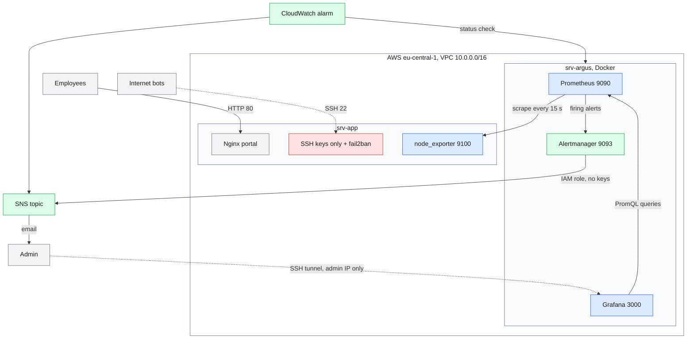

# Argus

**Protect, observe, react.** Argus hardens a Linux web server on AWS, monitors it from a second server and emails the administrator when something breaks. Everything is code: Terraform and one deploy script build the whole environment from scratch, and a check script verifies every layer.

---

## Initial situation

LogiTrans GmbH is a fictional logistics SME without a dedicated operations team. Its internal web portal runs on a single Linux server in the cloud, and nobody watches it:

- an outage is discovered when employees call IT;
- automated SSH login attempts go unnoticed;
- a full disk can stop the service without any warning.

## Objective and scope

Detect problems and attacks before users notice them, with open-source tools only and costs close to zero.

**In scope:** SSH access, network exposure, service availability (Nginx, fail2ban), machine health (CPU, memory, disk), email alerts, automatic recovery after a crash.
**Out of scope:** application-level attacks, central log analysis, high availability of the monitoring server, backups.

## Architecture

Two EC2 instances in one VPC (eu-central-1): **srv-app** serves the portal and protects itself, **srv-argus** watches it and sends the alerts. A CloudWatch alarm, outside both servers, watches the watcher.



Colours: red = protect, blue = observe, green = react.

| Layer | What does it |
|---|---|
| Protect | Key-only SSH, no root login, security groups and UFW with the same rules, fail2ban (1-hour ban after 3 failed logins; the admin's current IP is whitelisted at deployment) |
| Observe | node_exporter publishes CPU, memory, disk and the state of Nginx and fail2ban; Prometheus collects them every 15 seconds; Grafana shows them through an SSH tunnel |
| React | Four alert rules, Alertmanager sends FIRING and RESOLVED emails through SNS; systemd restarts Nginx 5 seconds after a crash |
| Watch the watcher | A CloudWatch alarm emails the admin if srv-argus itself goes down |

## Approach

The project was built in six phases: infrastructure (Terraform), hardening, application, monitoring, alerting, delivery. Each feature or fix was developed on its own branch and merged into `main`, so the Git history shows every step.

Every step was first tested by hand on a real server, then automated. The environment is disposable: it can be destroyed and rebuilt from scratch at any time, which proves that the scripts work on fresh servers, not only on a server configured by hand.

Values that differ per environment never live in the repository: configuration files hold placeholders, and `deploy.sh` fills them from the Terraform outputs and a local `.env` file. Every configuration is validated before a restart (`sshd -t`, `nginx -t`, `fail2ban-client -t`, `promtool`, `amtool`).

## Tools and decisions

| Choice | Why | Alternative considered |
|---|---|---|
| Terraform | Reviewable, versioned, rebuilt identically every time | AWS console: clicks nobody can repeat |
| Bash scripts | Standard Linux commands, no extra tool needed for two servers | Ansible, the better choice for a fleet |
| Prometheus + Grafana | Memory, disk and service state without paid agents; runs outside AWS too | CloudWatch alone: needs its agent and bills per metric. Used here to watch srv-argus |
| Pull model | A dead server is noticed at the next scrape (`up` = 0) | Push: a silent server and a dead server look the same |
| `Restart=on-failure` | A crash heals itself; a deliberate stop raises an alert | `Restart=always`, which would hide a stopped service |
| fail2ban `mode = aggressive` | With key-only SSH, a client without a key only leaves "connection closed" lines, which the default mode ignores | Default mode: banned nobody in testing |

## Outcome

- Two hardened servers, a monitoring stack and email alerting, built from nothing with `terraform apply` and `deploy.sh`.
- Four alerts: **NginxStopped**, **Fail2banStopped**, **ServerUnreachable** and **DiskAlmostFull**, plus the CloudWatch alarm on srv-argus.
- About two minutes from an outage to the email; the RESOLVED email follows about one minute after recovery.

### Repository structure

```
terraform/       VPC, security groups, instances, IAM role, SNS, CloudWatch, budget
config/          sshd, nginx, node_exporter, fail2ban, monitoring stack
scripts/         deploy.sh, check.sh, harden.sh, setup-app.sh, setup-argus.sh, ...
scripts/utils/   connect, tunnel, service, stack, crash-nginx, attack, bans, unban
```

### How to run

Prerequisites: an AWS account with the AWS CLI configured, Terraform, and an SSH key pair at `~/.ssh/argus`.

```bash
cp terraform/terraform.tfvars.example terraform/terraform.tfvars   # fill in your values
cp .env.example .env                                               # set a Grafana password
./scripts/update-ip.sh                                             # write your public IP into tfvars
cd terraform && terraform init && terraform apply && cd ..
# confirm the SNS subscription email before testing alerts
./scripts/deploy.sh
./scripts/check.sh
./scripts/utils/tunnel.sh       # then open localhost:3000 (Grafana), :9090, :9093
```

When finished: `cd terraform && terraform destroy`.

## Quality assurance

After every deployment, `check.sh` verifies each layer: SSH settings, firewall, portal, restart policy, metrics reachable from srv-argus only, fail2ban, containers, ports bound to 127.0.0.1, Prometheus target, alert rules.

Each alert was tested on the deployed AWS environment by reproducing the incident:

| Test | Result |
|---|---|
| `kill -9` on Nginx | Restarted by systemd after 5 s, no alert |
| Nginx stopped | FIRING email after ~2 min; RESOLVED ~1 min after restart |
| fail2ban or node_exporter stopped | FIRING and RESOLVED emails |
| srv-argus stopped | CloudWatch ALARM, then OK; the stack came back by itself |
| SSH attack from srv-argus | Three failures, then "Connection refused"; banned |
| Metrics during the ban | Port 22 refused, port 9100 open, Prometheus target up |
| Disk almost full | Rule validated with promtool; not filled live |

## Reflection

**Problems that taught me the most:**

- **Hardening made fail2ban blind.** With passwords disabled, an attacker without a key never produces a "failed password" line, and fail2ban's default mode banned nobody. `fail2ban-regex` showed 0 matches in normal mode and 7 in aggressive mode. One security measure can silently weaken another; only an end-to-end test reveals it.
- **The alert fired, but no email came.** The new SNS subscription had not been confirmed after the last `terraform apply`. Following the chain step by step (Prometheus, Alertmanager, SNS) found it in minutes.

**Limits and improvements:**

- Built for one application server, on purpose; more servers would need list outputs, parameterised scripts and a load balancer.
- Private subnets and AWS Session Manager instead of SSH by IP.
- A watchdog alert: CloudWatch sees whether srv-argus is alive, not whether Prometheus works.
- CI on pull requests: `terraform validate`, `shellcheck`, `promtool` and a secret scanner.

**Transfer:** for a larger fleet, Ansible would replace Bash and Prometheus would discover servers automatically; outside AWS, only SNS and CloudWatch need replacing.

## Security and data

- No secrets in the repository: `terraform.tfvars`, the Terraform state, `.env` and private keys are ignored by Git, and the full history was checked before publication.
- No AWS access keys on the servers: srv-argus publishes alerts through an IAM role limited to one SNS topic.
- All data is synthetic: LogiTrans GmbH is fictional and the portal is a static page.

## Use of AI

I used Claude (Anthropic) as a technical assistant throughout the project: to brainstorm and compare design options, to review and improve my scripts and configurations, to go deeper into specific topics, and to help draft this documentation. Every design decision is mine, and every command was run and tested on the real servers.

## Credits

- Grafana dashboard [Node Exporter Full (ID 1860)](https://grafana.com/grafana/dashboards/1860), a community dashboard, imported unchanged.
- Open-source tools: Terraform, Prometheus, Alertmanager, Grafana, node_exporter, fail2ban, Nginx, Docker, Ubuntu.

---

Argus is a demonstration project built with synthetic data. It is provided as is, without warranty; review and adapt it before any production use.
